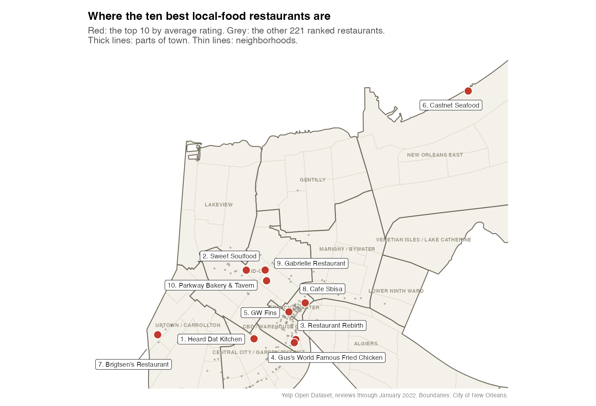
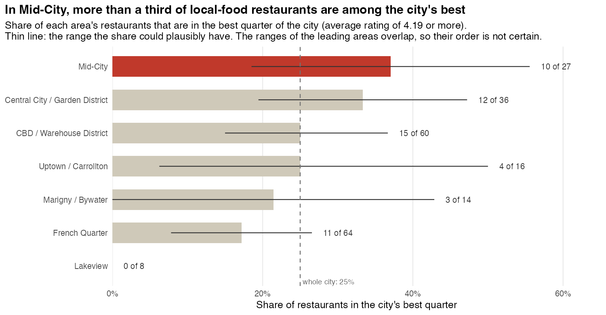
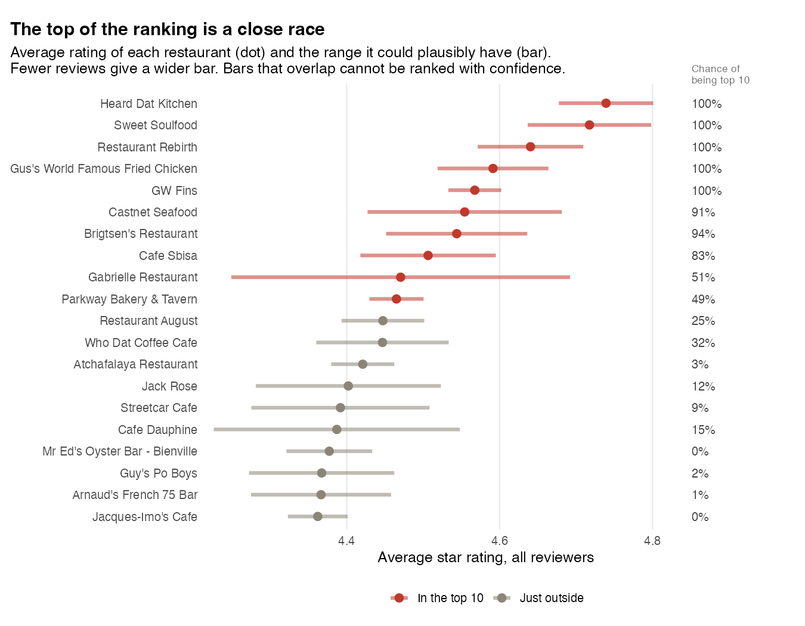

# Where to eat local in New Orleans

Say you get one evening in New Orleans and you want the food the city is famous for: gumbo, a po'boy,
fried chicken, oysters. Where do you go, and which part of town gives you the best odds?

I answered that with the Yelp Open Dataset: 6,990,280 reviews in one 5 GB file, of which 238,474 are
about the 608 New Orleans restaurants that serve Cajun or Creole food, Southern food, soul food or seafood.

**Start here:** [the story, as a city of lights](https://jamv8.github.io/where-to-eat-local-in-new-orleans/)
· **Then:** [the full report](https://jamv8.github.io/where-to-eat-local-in-new-orleans/report.html)

This is Project 2 for Math 167R.

## The short answer

**1. The ten best.** Ranked by average rating, among the 231 open restaurants with enough reviews to judge.
The last column says how often each one stayed in the top ten when I reshuffled the reviews 2,000 times.

| # | Restaurant | Part of town | Reviews | Stars | Stayed top ten |
|--:|---|---|--:|--:|--:|
| 1 | Heard Dat Kitchen | Central City / Garden District | 579 | 4.74 | 100% |
| 2 | Sweet Soulfood | Mid-City / Tremé / Bayou St. John | 393 | 4.72 | 100% |
| 3 | Restaurant Rebirth | CBD / Warehouse District | 534 | 4.64 | 100% |
| 4 | Gus's World Famous Fried Chicken | CBD / Warehouse District | 536 | 4.59 | 100% |
| 5 | GW Fins | French Quarter | 2,502 | 4.57 | 100% |
| 6 | Castnet Seafood | New Orleans East | 184 | 4.55 | 91% |
| 7 | Brigtsen's Restaurant | Uptown / Carrollton | 353 | 4.54 | 94% |
| 8 | Cafe Sbisa | French Quarter | 537 | 4.51 | 83% |
| 9 | Gabrielle Restaurant | Mid-City / Tremé / Bayou St. John | 85 | 4.47 | 51% |
| 10 | Parkway Bakery & Tavern | Mid-City / Tremé / Bayou St. John | 2,223 | 4.47 | 49% |

**2. The best part of town is Mid-City / Tremé / Bayou St. John.** 10 of its 27 ranked restaurants (37%)
are in the top quarter of the city. In the French Quarter it is 11 of 64 (17%). The lead is small:
Central City / Garden District is right behind at 33%, and the winner comes out first in 50% of reshuffles.

**3. The tourist center is not where the best local food is.** The French Quarter and the business
district hold 54% of the ranked restaurants, but their average restaurant rates 3.83 against 4.00 in the
rest of the city (a difference of 0.17 stars, 95% interval 0.07 to 0.27).

**4. A top ten is never exact.** Seven of the ten are there in at least 90% of reshuffles. The last three
seats are contested: 18 restaurants have a realistic chance at them.

## How I got there

- **What counts.** A restaurant is in New Orleans if its coordinates fall inside the official city
  boundary. Yelp's city field is typed by hand: 57 places labeled "New Orleans" are in the suburbs.
- **The theme.** Four Yelp categories that go together: Cajun/Creole, Southern, Soul Food and Seafood.
  Any two of them show up on the same restaurant two to four times more often than chance.
- **The areas.** I compared six ways of dividing the city. Census tracts and block groups are too small
  (one or two restaurants each); ZIP codes and wards mean nothing to a visitor. I used the city's
  planning districts for "which part of town" and neighborhoods for the detail inside.
- **The ranking.** Average of all star ratings, for open restaurants with at least 30 reviews from
  active reviewers (people with five or more reviews of these restaurants).
- **The check on reviewers.** A four from someone who gives everyone five is not the same as a four
  from a tough grader. I compared each rating with that reviewer's own average. Eight of the ten stay in
  the top ten after this adjustment.
- **The check on luck.** A bootstrap: redraw each restaurant's reviews from its own reviews, rank
  everyone again, repeat 2,000 times.
- **The check on me.** 19 self-checks, three of them against outside information: the line count of the
  raw file, Yelp's own review counts and star ratings, and the known locations of eight landmark restaurants.

## What is in this repository

| Path | What it is |
|---|---|
| `index.html`, `assets/` | The story site. It draws only what `R/12_site_data.R` exports |
| `report.qmd` | The statistical report. Every number in its text is computed from `results/` |
| `R/01_import.R` … `R/12_site_data.R` | The analysis, one numbered script per step |
| `results/` | Every table the scripts produce, as CSV |
| `figures/` | Every chart and map the scripts produce |
| `data/new_orleans/` | The filtered data the analysis runs on |
| `data/boundaries/` | City boundary, parts of town, neighborhoods, wards, ZIP areas, census areas, water |
| `docs/` | The rendered site and report, served by GitHub Pages |
| `renv.lock` | Exact package versions |

## Run it yourself

1. **Get the data.** Download the Yelp Open Dataset from
   <https://business.yelp.com/data/resources/open-dataset/>. From the archive, put
   `yelp_academic_dataset_business.json` and `yelp_academic_dataset_review.json` into `data/raw/`.
2. **Restore the packages:** `renv::restore()` in R.
3. **Run the scripts in order,** from the project root: `Rscript R/01_import.R`, then `02` through `12`.
   Scripts `01` and `11` read the raw files, and `04` and `05` read an intermediate review file that `01`
   creates. From `06` on, everything runs from the filtered tables in this repository.
4. **Build the pages:** `quarto render`.

**Why the raw files are not here.** The review file is 5 GB and GitHub rejects files over 100 MB.
`data/raw/` is in `.gitignore`. The import reads the file 100,000 lines at a time and keeps only what the
analysis needs: that takes 2 GB of memory, where reading the whole file at once takes 18 GB.

## What this cannot tell you

- Whether a place is still open. The reviews stop in January 2022.
- What people who never write reviews think.
- Whether Yelp's labels are right. A fried-chicken chain from Tennessee is in the top ten because Yelp
  files it under Southern.
- Anything about new or small places: 155 of the 386 open restaurants have too few reviews to rank.

## Sources

Yelp Open Dataset · U.S. Census Bureau boundaries, through the `tigris` package · neighborhoods, wards and
planning districts from [data.nola.gov](https://data.nola.gov/).
