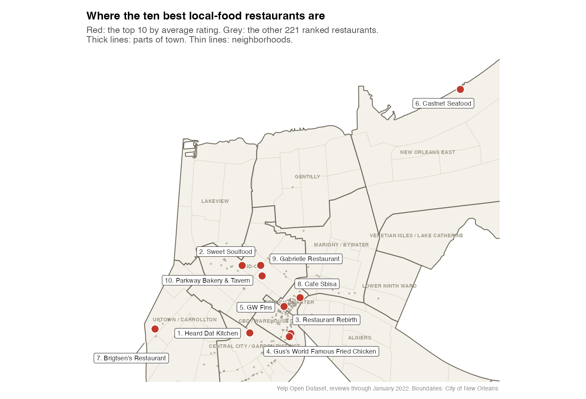
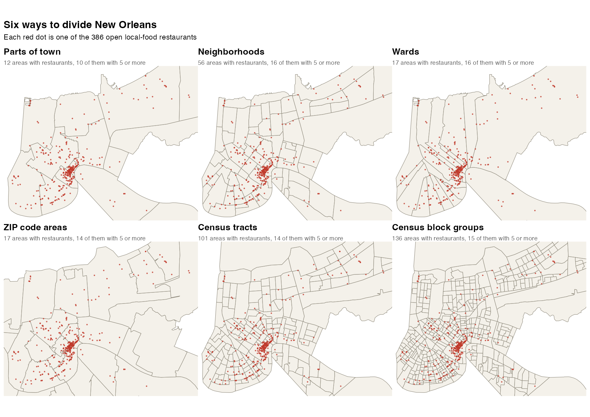
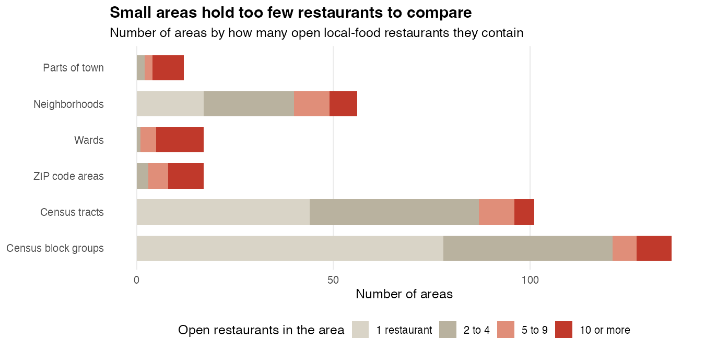
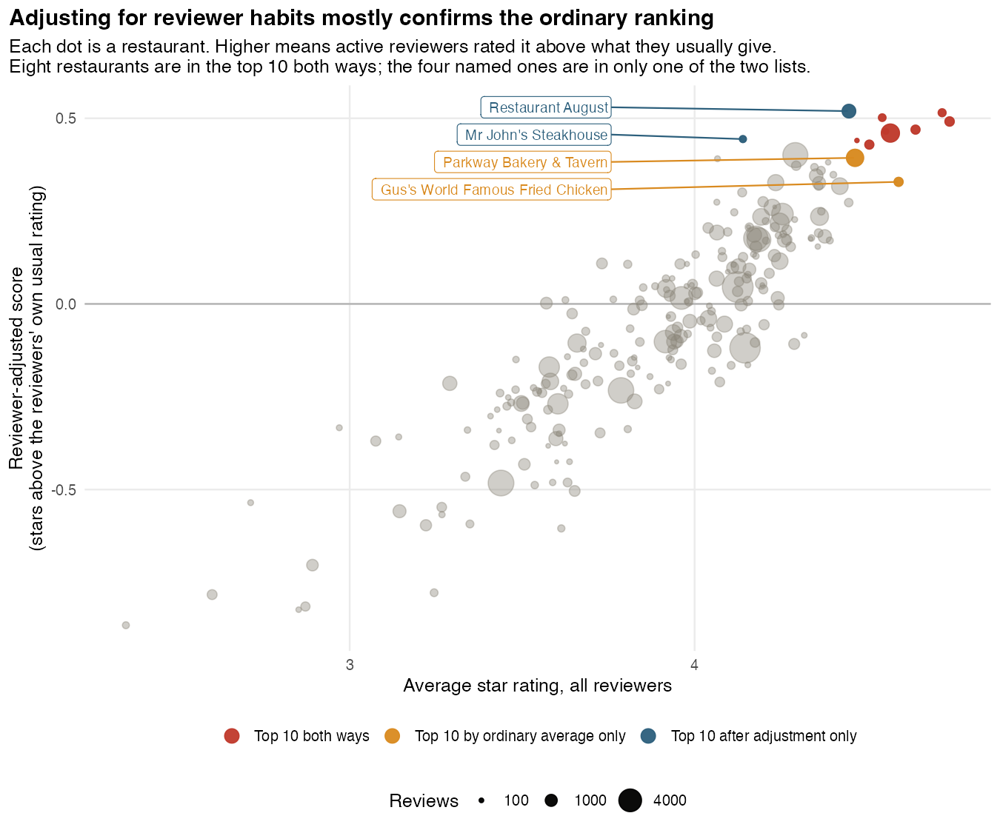
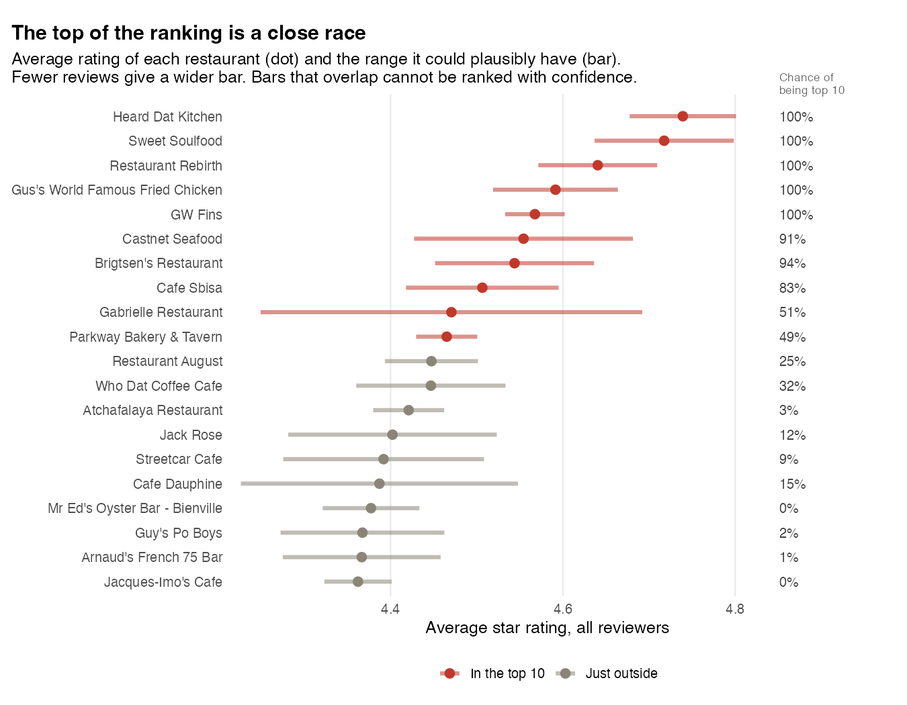
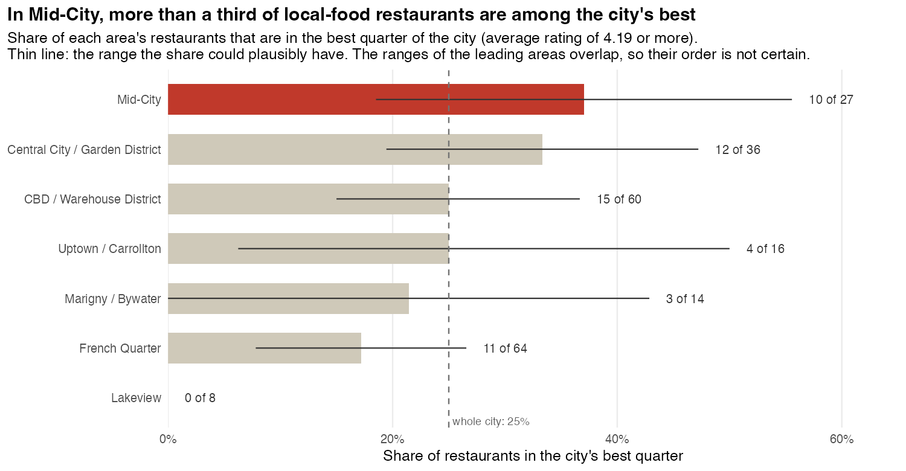
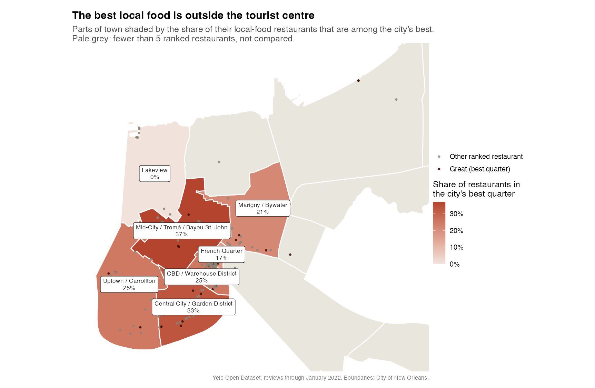

```{r}
#| label: setup
#| include: false
library(dplyr)
library(knitr)

res <- function(file) read.csv(file.path("results", file), check.names = FALSE)
n   <- function(x) format(round(x), big.mark = ",")                       # 6,990,280
pct <- function(x, digits = 0) paste0(formatC(100 * x, format = "f", digits = digits), "%")
f2  <- function(x) formatC(x, format = "f", digits = 2)

import_log <- res("import_log.csv")
benchmark  <- res("import_benchmark.csv")
city_check <- res("city_vs_boundary.csv")
inclusion  <- res("theme_inclusion_summary.csv")
cat_counts <- res("theme_category_counts.csv")
cat_pairs  <- res("theme_category_pairs.csv")
coverage   <- res("theme_area_coverage.csv")
geography  <- res("geography_comparison.csv")
thresholds <- res("reviewer_thresholds.csv")
thr_sens   <- res("threshold_sensitivity.csv")
mean_med   <- res("baseline_mean_vs_median.csv")
scores     <- res("restaurant_scores.csv")
top10      <- res("top10.csv")
stability  <- res("ranking_stability.csv")
stab_sum   <- res("stability_summary.csv")
areas      <- res("area_scores.csv")
cutoffs    <- res("area_cutoff_sensitivity.csv")
robust     <- res("area_method_robustness.csv")
centre     <- res("centre_vs_rest.csv")
beats_fq   <- res("beats_french_quarter.csv")
nbhd       <- res("neighborhood_scores.csv")
checks     <- res("checks.csv")
excluded   <- res("theme_excluded.csv")

business <- readRDS("data/new_orleans/business_new_orleans.rds")
reviews  <- readRDS("data/new_orleans/theme_reviews.rds")

# numbers used in the text
review_row   <- import_log[grepl("review", import_log$step), ]
in_city      <- sum(city_check$restaurants[city_check$place_name %in% "New Orleans"])
label_out    <- sum(city_check$restaurants[city_check$city_clean == "New Orleans" & !(city_check$place_name %in% "New Orleans")])
label_other  <- sum(city_check$restaurants[city_check$place_name %in% "New Orleans" & city_check$city_clean != "New Orleans"])
theme_n      <- sum(inclusion$restaurants[!grepl("left out", inclusion$step)])
theme_open   <- sum(inclusion$open[!grepl("left out", inclusion$step)])
ranked       <- filter(scores, ranked)
n_ranked     <- nrow(ranked)
thr5         <- thresholds[thresholds$threshold == 5, ]
ord          <- stab_sum[stab_sum$ranking == "ordinary", ]
adj          <- stab_sum[stab_sum$ranking == "adjusted", ]
compared     <- filter(areas, compared)
leader       <- compared[1, ]
second       <- compared[2, ]
fq           <- compared[compared$part_of_town == "French Quarter", ]
great_cut    <- cutoffs$rating_cut[cutoffs$great_means_best == "25%"]
tourist      <- centre[centre$where == "Tourist centre", ]
rest         <- centre[centre$where == "Rest of the city", ]
bench        <- function(m, col) benchmark[benchmark$method == m, col]
geo_open     <- function(system, col) geography[geography$scope == "open" & geography$system == system, col]
```

::: {.callout-tip appearance="simple"}
## In plain words
I used `r n(review_row$rows_read)` Yelp reviews to find the best places for local food in New Orleans:
Cajun and Creole cooking, Southern food, soul food and seafood. Two things came out. **The ten best
restaurants are spread over `r n_distinct(top10$part_of_town)` parts of the city, and only
`r sum(top10$part_of_town == "French Quarter")` of them are in the French Quarter.**
And **the part of town where your chance of walking into a great place is highest is
`r leader$part_of_town`**, not the tourist centre. A top-ten list from star ratings is never exact, so
for every restaurant I also report how likely it is to really belong in the top ten.
:::

## Executive summary

**Question.** Where can someone find the best local-food restaurants in New Orleans, and which
geographic area is best for finding them?

**Data.** The Yelp Open Dataset: `r n(review_row$rows_read)` reviews in one `r f2(review_row$file_size_gb)` GB
file. After filtering to the city and the theme, the analysis uses `r n(nrow(reviews))` reviews of
`r n(theme_n)` restaurants written by `r n(n_distinct(reviews$user_id))` reviewers between
`r format(min(reviews$date), "%B %Y")` and `r format(max(reviews$date), "%B %Y")`.

**Answer.**

1. **The top ten.** `r paste(top10$business_name[1:3], collapse = ", ")` lead the list; the full ten are
   in the first table below. `r ord$restaurants_with_90pct_chance` of them are in the top ten in at least
   90% of 2,000 resamples of the reviews. The last places are a close race: `r ord$restaurants_with_5pct_chance` restaurants have
   a realistic chance at ten places.
2. **The best part of town.** `r leader$part_of_town`: `r leader$great_restaurants` of its
   `r leader$restaurants` ranked restaurants (`r pct(leader$share_great)`) are in the best quarter of
   the city, against `r pct(fq$share_great)` in the French Quarter. Its lead over
   `r second$part_of_town` (`r pct(second$share_great)`) is small: it comes first in
   `r pct(leader$chance_first)` of resamples.
3. **Reviewer habits change little.** After adjusting each rating for how generous its reviewer
   usually is, `r sum(top10$also_top10_after_adjustment)` of the ten restaurants are still in the top ten.

## The answer first

A restaurant is ranked by the average of all its star ratings. To be ranked it must be open and have
at least 30 reviews from active reviewers (people with five or more reviews of local-food
restaurants). `r n_ranked` restaurants qualify. The reasons for each rule are in the sections below.

```{r}
#| label: tbl-top10
#| tbl-cap: "The ten best local-food restaurants in New Orleans. The interval is the range the true average could plausibly have (95%). The chance is the share of 2,000 resamples in which the restaurant is in the top ten."
top10 |>
  transmute(
    Rank = rank,
    Restaurant = business_name,
    `Part of town` = part_of_town,
    Reviews = n(reviews_all),
    `Average stars` = f2(ordinary_average),
    Interval = paste(f2(ordinary_low), "to", f2(ordinary_high)),
    `Chance of being top 10` = pct(ordinary_chance_top10),
    `Still top 10 after reviewer adjustment` = ifelse(also_top10_after_adjustment, "yes", paste0("no (rank ", rank_adjusted, ")"))
  ) |>
  kable(align = "rllrrlrl")
```

{#fig-top10-map}

## The data, and how I handled a 5 GB file

The Yelp Open Dataset comes as one 4.35 GB zip archive. Inside the zip is a tar archive, and inside
that are five JSON files with one record per line. I needed two of them.

| File | Size | Rows |
|---|---:|---:|
| `yelp_academic_dataset_business.json` | 0.11 GB | `r n(import_log$rows_read[1])` |
| `yelp_academic_dataset_review.json` | `r f2(review_row$file_size_gb)` GB | `r n(review_row$rows_read)` |

**Problems and what I did about them.**

- **An archive inside an archive, and limited reason to unpack all of it.** The two files I needed
  take 5.5 GB once unpacked. I extracted only those two, left the other three (users, tips and
  check-ins) packed, and deleted the intermediate tar.
- **The review file does not fit comfortably in memory.** The assignment's template reads it in one
  call. I measured that: it works on my computer only because it has 48 GB of memory.
  [`R/01_import.R`](https://github.com/JamV8/where-to-eat-local-in-new-orleans/blob/main/R/01_import.R)
  instead reads 100,000 lines at a time and keeps only the rows and columns it needs from each chunk.
- **Most of the file is not about New Orleans.** Only `r n(review_row$rows_kept)` of the
  `r n(review_row$rows_read)` reviews (`r pct(review_row$rows_kept / review_row$rows_read)`) are about
  a Louisiana business. They are filtered during the import, so the full file is never held at once.
- **Review text is the heavy part.** The analysis uses only the star rating, so the text is dropped.
  The final review table (`r n(nrow(reviews))` rows) is a
  `r round(file.size("data/new_orleans/theme_reviews.rds") / 1e6)` MB compressed `.rds` file.
- **Raw files cannot go to GitHub.** GitHub rejects files over 100 MB. `data/raw/` is listed in
  `.gitignore`; the repository holds only the filtered tables.
- **Two bugs in the template code.** Review dates are timestamps such as `2018-07-07 22:09:11`, so
  `ymd()` returns missing values and `ymd_hms()` is needed. And block group names such as
  "Block Group 2" repeat in every census tract, so they must be combined with the tract number
  before they can identify an area.

**Three ways to read the file, measured.** Each method ran in its own R process and had to read the
same `r n(bench("chunked", "rows_read"))` rows and keep the same `r n(bench("chunked", "rows_kept"))`.

```{r}
#| label: tbl-benchmark
#| tbl-cap: "Time and peak memory for three ways of getting the Louisiana reviews out of the review file, on a laptop with 48 GB of memory."
benchmark |>
  mutate(Method = c(chunked    = "Chunks of 100,000 lines (what this project does)",
                    duckdb     = "DuckDB, a database engine that scans the file",
                    duckdb_2gb = "DuckDB with its memory capped at 2 GB",
                    whole      = "Whole file in one call (the template)")[method]) |>
  arrange(match(method, c("whole", "chunked", "duckdb", "duckdb_2gb"))) |>
  transmute(Method, `Rows read` = n(rows_read), `Rows kept` = n(rows_kept),
            Seconds = round(seconds), `Peak memory, GB` = formatC(peak_memory_gb, format = "f", digits = 1)) |>
  kable(align = "lrrrr")
```

Reading the whole file needs `r formatC(bench("whole", "peak_memory_gb"), format = "f", digits = 0)` GB,
more than three times the size of the file and more than most laptops have. Chunking does the same
job in about the same time with `r formatC(bench("chunked", "peak_memory_gb"), format = "f", digits = 0)` GB.
DuckDB is about `r round(bench("chunked", "seconds") / bench("duckdb", "seconds"))` times faster than
either. I kept the chunked import as the project's method because it is the one the course teaches
and it runs only once; DuckDB is what I would reach for if the file had to be read often.

## What counts as a New Orleans restaurant

A restaurant is any business whose Yelp categories include "Restaurants", as in the assignment.
It is **in New Orleans** if its coordinates fall inside the official Census boundary of the city.
I did not use Yelp's city field, because it is typed by hand: `r label_out` restaurants labelled
"New Orleans" lie outside the boundary, in suburbs such as Elmwood, Jefferson and Harahan, and
`r label_other` inside it carry another city name. The boundary gives `r n(in_city)` restaurants, `r n(sum(business$is_open == 1))` of
them still open when the data end.

Closed restaurants are not ranked, because nobody can go to them. Their reviews are still used to
learn each reviewer's habits.

## The theme: local food

I chose four related Yelp categories: **Cajun/Creole, Southern, Soul Food and Seafood**. A
restaurant belongs to the theme if it carries at least one of them.

```{r}
#| label: tbl-categories
#| tbl-cap: "Restaurants in each category (a restaurant can carry several)."
cat_counts |>
  transmute(Category = category, Restaurants = n(restaurants), `Still open` = n(open)) |>
  kable(align = "lrr")
```

**Do the categories belong together?** If Yelp handed out these labels independently of each other,
few restaurants would carry two of them. They carry two far more often than that.

```{r}
#| label: tbl-pairs
#| tbl-cap: "How often two categories appear on the same restaurant, among all New Orleans restaurants. 'Times more than chance' compares the observed count with the count expected if the labels were unrelated."
cat_pairs |>
  arrange(desc(lift)) |>
  transmute(`Category A` = category_a, `Category B` = category_b,
            `Restaurants with both` = both,
            `Expected by chance` = round(expected_if_independent),
            `Times more than chance` = formatC(lift, format = "f", digits = 1)) |>
  kable(align = "llrrr")
```

Every pair appears together about two to four times more often than chance. The largest overlap
is Cajun/Creole with Seafood, on
`r cat_pairs$both[cat_pairs$category_a == "cajun/creole" & cat_pairs$category_b == "seafood"]` restaurants:
this is the cooking of the Gulf coast.

**One exception for Seafood.** The other three labels name a cooking tradition. "Seafood" names an
ingredient, and a sushi bar carries it too. So a restaurant that enters the theme *only* through
Seafood is left out when Yelp also labels it with another country's cuisine (Japanese, Peruvian,
Italian and so on).

```{r}
#| label: tbl-inclusion
#| tbl-cap: "Who is in the theme."
inclusion |>
  transmute(Group = sub("^[0-9]\\. ", "", step), Restaurants = restaurants, `Still open` = open) |>
  kable(align = "lrr")
```

The rule keeps well-known seafood houses such as Drago's, GW Fins, Pêche and Casamento's, and leaves
out `r nrow(excluded)` places such as a Peruvian ceviche bar and several sushi restaurants. All of
them are listed in [`results/theme_excluded.csv`](https://github.com/JamV8/where-to-eat-local-in-new-orleans/blob/main/results/theme_excluded.csv).
The rule is not perfect; its costs are in the limitations.

**Enough restaurants in enough areas.** The assignment asks for at least 10 restaurants in at least
7 areas. The theme has `r n(theme_n)` restaurants (`r n(theme_open)` open), spread as follows.

```{r}
#| label: tbl-coverage
#| tbl-cap: "Areas that contain at least one restaurant of the theme, under each way of dividing the city."
coverage |>
  transmute(`Geographic system` = system, `Areas in the city` = areas_in_city,
            `Areas with theme restaurants` = areas_with_theme,
            `Areas with open theme restaurants` = areas_with_theme_open) |>
  kable(align = "lrrr")
```

## How to divide the city

I compared six ways of dividing New Orleans: the five named in the assignment and the city's
planning districts, which I call **parts of town**.

{#fig-systems}

```{r}
#| label: tbl-geography
#| tbl-cap: "Comparison of geographic systems, for the open restaurants of the theme. An area with fewer than 5 restaurants is too small to compare."
geography |>
  filter(scope == "open") |>
  transmute(`Geographic system` = system,
            `Areas with restaurants` = areas_with_restaurants,
            `Restaurants assigned` = restaurants_assigned,
            Unmatched = unmatched_restaurants,
            `Smallest area` = smallest_area_count,
            `Typical area (median)` = median_area_count,
            `Largest area` = largest_area_count,
            `Areas too small` = areas_too_small,
            `Restaurants in areas large enough` = pct(share_of_restaurants_in_large_enough_areas)) |>
  kable(align = "lrrrrrrrr")
```

{#fig-area-sizes}

**My choice: two levels.** Parts of town answer "which part of the city should I go to", and
Neighborhood Statistical Areas give the detail inside each part.

- **Census tracts and block groups are too small.** The typical one holds one or two restaurants,
  and four to five of every ten restaurants sit in areas too small to compare.
- **ZIP code areas and wards are large enough but mean little to a visitor.** Nobody plans dinner in
  "Ward 7" or "70130", and a single ZIP area holds `r pct(geo_open("ZIP code areas", "share_in_largest_area"))`
  of the restaurants.
- **Neighborhoods have names people use**, but `r geo_open("Neighborhoods", "areas_too_small")` of the
  `r geo_open("Neighborhoods", "areas_with_restaurants")` that contain a restaurant have fewer than five,
  which leaves `r pct(1 - geo_open("Neighborhoods", "share_of_restaurants_in_large_enough_areas"))` of
  restaurants out of any comparison.
- **Parts of town are how the city is usually described**: Uptown, Mid-City, Marigny and Bywater.
  They are the City Planning Commission's official grouping of the same neighborhoods, and almost
  every restaurant sits in a part of town large enough to compare.

The planning district file carries only numbers, so the names are mine, following the names the
Commission uses. I labelled District 4 "Mid-City / Tremé / Bayou St. John" instead of the short
official "Mid-City", for a reason that appears in the results.

## Reviewers, and a score adjusted for their habits

The same four stars mean different things from different people. A reviewer who gives almost
everyone five stars is disappointed at four; a reviewer who usually gives three is impressed.

**Active reviewers.** A reviewer's habits can only be measured with several reviews. I call a
reviewer active with five or more reviews of theme restaurants, the threshold the assignment suggests.

```{r}
#| label: tbl-thresholds
#| tbl-cap: "What each activity threshold keeps. The last three columns show how different active reviewers are from each other: the usual rating of a strict one, a typical one and a generous one."
thresholds |>
  transmute(`Reviews needed` = threshold, `Reviewers kept` = n(reviewers_kept),
            `Share of reviewers` = pct(share_of_reviewers, 1), `Reviews kept` = n(reviews_kept),
            `Share of reviews` = pct(share_of_reviews), `Strict (5th percentile)` = f2(baseline_5th_pct),
            Typical = f2(baseline_median), `Generous (95th percentile)` = f2(baseline_95th_pct)) |>
  kable(align = "rrrrrrrr")
```

With a threshold of 5, `r n(thr5$reviewers_kept)` reviewers remain. They are only
`r pct(thr5$share_of_reviewers, 1)` of all reviewers but wrote `r pct(thr5$share_of_reviews)` of the
reviews. A threshold of 3 keeps more reviews but describes a person from three ratings; a threshold
of 10 leaves under a tenth of the reviews.

**The baseline is the reviewer's mean, not the median.** Stars are whole numbers, so a median is
almost always exactly 4 or 5 (`r pct(mean_med$share_of_active_reviewers_with_median_4_or_5)` of
active reviewers) and stops telling reviewers apart.

**The adjusted score** of a review is its stars minus that reviewer's mean. The adjusted score of a
restaurant is the average of these differences. It is not a new Yelp rating: +0.5 means "active
reviewers gave this place half a star more than they usually give".

**Which number ranks the restaurants?** I computed both and tested both. The adjusted score is
fairer in principle, but it uses under a quarter of the reviews, so it is noisier. On the same
`r n_ranked` restaurants:

```{r}
#| label: tbl-stability
#| tbl-cap: "How well each ranking's top ten survives 2,000 resamples of the reviews."
stab_sum |>
  transmute(Ranking = c(ordinary = "Ordinary average, all reviewers", adjusted = "Adjusted score, active reviewers")[ranking],
            `Top-10 members that keep their place, on average` = formatC(average_top10_members_kept, format = "f", digits = 1),
            `Restaurants in the top 10 at least 90% of the time` = restaurants_with_90pct_chance,
            `Restaurants with a realistic chance (5% or more)` = restaurants_with_5pct_chance) |>
  kable(align = "lrrr")
```

So the ordinary average ranks the restaurants, and the adjusted score is the check: does a
restaurant stay near the top once reviewer habits are removed?

{#fig-scatter}

`r sum(top10$also_top10_after_adjustment)` of the ten stay in the top ten after the adjustment. The
restaurants that move are worth reading:

```{r}
#| label: tbl-movers
#| tbl-cap: "Restaurants that are in one top ten but not the other."
stability |>
  filter((rank_ordinary <= 10) != (rank_adjusted <= 10)) |>
  arrange(rank_ordinary) |>
  transmute(Restaurant = business_name, Reviews = n(reviews_all), `Average stars` = f2(ordinary_average),
            `Rank by average` = rank_ordinary, `Reviews from active reviewers` = n(reviews_active),
            `Adjusted score` = sprintf("%+.2f", adjusted_score), `Rank after adjustment` = rank_adjusted) |>
  kable(align = "lrrrrrr")
```

Gus's is rated higher by occasional reviewers than by regulars relative to their own habits. It is
also a chain from Tennessee that entered the theme through its "Southern" label. Restaurant August
and Mr John's Steakhouse are places that active reviewers rate well above their usual level.

**Does the threshold change the answer?** Barely.

```{r}
#| label: tbl-threshold-sensitivity
#| tbl-cap: "The top ten under other definitions of an active reviewer."
thr_sens |>
  transmute(`Reviews needed to be active` = threshold, `Restaurants ranked` = restaurants_ranked,
            `Of the main top 10, still in the top 10` = main_top10_still_in_ordinary_top10,
            `Top 10 that is also top 10 after adjustment` = ordinary_top10_also_adjusted_top10) |>
  kable(align = "rrrr")
```

## How sure is the top ten?

An average rating is an estimate from the people who happened to write a review. Two tools show how
far it can be trusted.

**Intervals.** For each restaurant, the average plus or minus 1.96 standard errors. Fewer reviews
give a wider interval, and overlapping intervals mean two restaurants cannot be ranked with confidence.

**Bootstrap.** I put each restaurant's reviews in a hat, drew the same number of reviews back out
with replacement, recomputed every average and ranked all `r n_ranked` restaurants again. Repeating
this 2,000 times gives 2,000 versions of the ranking; the chance of being in the top ten is the
share of versions in which a restaurant makes it.

{#fig-intervals}

- The exact same ten restaurants come back in `r pct(ord$share_with_identical_top10)` of resamples.
- On average `r formatC(ord$average_top10_members_kept, format = "f", digits = 1)` of the ten keep their place.
- `r ord$restaurants_with_90pct_chance` restaurants are in the top ten at least 90% of the time.
  The last places are contested: `r top10$business_name[9]` and `r top10$business_name[10]` each make
  the top ten in about half of the resamples.

The honest reading is "`r ord$restaurants_with_90pct_chance` restaurants that belong in the top ten,
and `r ord$restaurants_with_5pct_chance - ord$restaurants_with_90pct_chance` more competing for the last
`r 10 - ord$restaurants_with_90pct_chance` places".

## The best part of town

**The measure.** The question asks where to *find the best restaurants*, so I score a part of town
by the share of its ranked restaurants that are among the city's best quarter (an average of
`r f2(great_cut)` stars or more). It reads as "if I pick a local-food restaurant here, what is the
chance it is one of the city's best?" Only parts of town with five or more ranked restaurants are compared.

```{r}
#| label: tbl-areas
#| tbl-cap: "Parts of town with five or more ranked restaurants. 'Chance of being first' is the share of 5,000 resamples of each area's restaurants in which that area has the highest share."
compared |>
  transmute(`Part of town` = part_of_town, `Ranked restaurants` = restaurants,
            `In the city's best quarter` = great_restaurants, Share = pct(share_great),
            `Chance of being first` = pct(chance_first), `Average stars` = f2(average_rating),
            `Adjusted score` = sprintf("%+.2f", adjusted_score), `Top-10 restaurants` = top10_restaurants) |>
  kable(align = "lrrrrrrr")
```

{#fig-areas}

{#fig-areas-map}

**The answer is `r leader$part_of_town`**, with `r leader$great_restaurants` great restaurants out
of `r leader$restaurants` and `r leader$top10_restaurants` of the top ten. How strong is that?

- It is the most likely leader, not a proven one: first in `r pct(leader$chance_first)` of resamples
  and in the first three in `r pct(leader$chance_top3)`. `r second$part_of_town` is close behind.
- It stays first if "great" means the best 20% or the best 33% of the city. With the best 10% only
  `r cutoffs$great_in_city[cutoffs$great_means_best == "10%"]` restaurants are left in the whole city,
  the count per area drops to two or three, and `r cutoffs$first[cutoffs$great_means_best == "10%"]` comes first.
- I tried 24 other ways of scoring an area (three sets of restaurants, eight measures). No area wins
  them all, which is what a close race looks like. The list is in
  [`results/area_method_robustness.csv`](https://github.com/JamV8/where-to-eat-local-in-new-orleans/blob/main/results/area_method_robustness.csv).

**The tourist centre is not where the best local food is.** This part of the answer is firmer. The
French Quarter and the CBD together hold `r pct(tourist$restaurants / n_ranked)` of the ranked
restaurants, but their average
restaurant is rated `r f2(tourist$average_rating)` against `r f2(rest$average_rating)` in the rest of
the city: a difference of `r f2(rest$rating_difference)` stars (95% interval
`r f2(rest$rating_difference_low)` to `r f2(rest$rating_difference_high)`). On the share of great
restaurants the gap points the same way, `r pct(tourist$share_great)` against `r pct(rest$share_great)`,
but with this many restaurants it could still be chance (p = `r f2(rest$share_p_value)`).

**Inside the winning part of town.** The second level shows where exactly to go.

```{r}
#| label: tbl-neighborhoods
#| tbl-cap: "Neighborhoods inside the leading part of town."
nbhd |>
  filter(part_of_town == leader$part_of_town) |>
  arrange(desc(great_restaurants), desc(restaurants)) |>
  transmute(Neighborhood = neighborhood, `Ranked restaurants` = restaurants,
            `In the city's best quarter` = great_restaurants, `Average stars` = f2(average_rating),
            `Top-10 restaurants` = top10_restaurants) |>
  kable(align = "lrrrr")
```

The neighborhood that gives the district its official name, Mid-City, is not what makes it win.
The strength is in Tremé and Bayou St. John, which hold all three of its top-ten restaurants. That
is why the part of town carries the longer name in this report.

## Self-check

Every result above passes through `r nrow(checks)` checks in
[`R/10_checks.R`](https://github.com/JamV8/where-to-eat-local-in-new-orleans/blob/main/R/10_checks.R).
Three of them compare my numbers with information from outside my own calculations: the line count
of the raw file, the review counts and star ratings Yelp publishes for each restaurant, and the
known locations of eight famous restaurants.

```{r}
#| label: tbl-checks
#| tbl-cap: "Self-check results."
checks |>
  transmute(Area = group, Question = question, Result = result, Detail = detail) |>
  kable(align = "llll")
```

## Limitations

- **The data end in January 2022.** "Open" means open then. Some of these restaurants have closed
  since and new ones are missing.
- **Yelp reviewers are not a random sample of diners.** A rating reflects the people who chose to
  write, and tourists and residents write for different reasons.
- **Yelp's labels are loose.** The top ten contains a fried-chicken chain from Tennessee labelled
  "Southern". A few steakhouses are in the theme because they carry "Seafood". The Seafood exception
  also removes a few places most people would call local, because Yelp gives them a French or
  Italian label.
- **`r sum(scores$is_open == 1) - n_ranked` of the `r sum(scores$is_open == 1)` open restaurants are
  not ranked**, because they have fewer than 30 reviews from active reviewers. New and small places
  are invisible here.
- **The adjusted score rests on a small group**: `r pct(thr5$share_of_reviewers, 1)` of reviewers,
  the most active ones. Their taste may differ from an ordinary visitor's.
- **Only `r nrow(compared)` parts of town could be compared.** New Orleans East, Gentilly, Algiers and
  the Lower Ninth Ward have too few ranked restaurants to say anything.
- **The bootstrap treats reviews as independent** and each reviewer's usual rating as known. Both
  are simplifications.
- **I looked at trial results while choosing the rules.** The choice between ranking by the ordinary
  average or by the adjusted score was made after testing both, on stability, not on which
  restaurants came out on top. The rules for restaurants were fixed before I looked at parts of town.

## Reproduce it

The scripts run in order from the project root. Only the first one and the benchmark need the raw
Yelp files; everything else runs from the filtered tables in the repository.

| Script | What it does |
|---|---|
| `R/01_import.R` | Reads the raw JSON in chunks, keeps Louisiana |
| `R/02_boundaries.R` | Downloads the city boundary and six sets of area boundaries |
| `R/03_clean.R` | Defines New Orleans restaurants, attaches every area label |
| `R/04_theme_candidates.R` | Compares ten candidate themes |
| `R/05_theme.R` | Builds the local-food theme, category counts and co-occurrence |
| `R/06_geography.R` | Compares the six geographic systems |
| `R/07_scores.R` | Reviewer baselines, ordinary average and adjusted score |
| `R/08_top10.R` | Top ten, intervals, bootstrap, map |
| `R/09_areas.R` | Scores for parts of town and neighborhoods |
| `R/10_checks.R` | Self-check |
| `R/11_import_benchmark.R` | Measures three ways of reading the review file |

Package versions are recorded in `renv.lock`. The random seed is 9426.

**Sources.** [Yelp Open Dataset](https://business.yelp.com/data/resources/open-dataset/);
U.S. Census Bureau boundaries through the [`tigris`](https://walker-data.com/tigris/) package;
neighborhoods, wards and planning districts from [data.nola.gov](https://data.nola.gov/).
